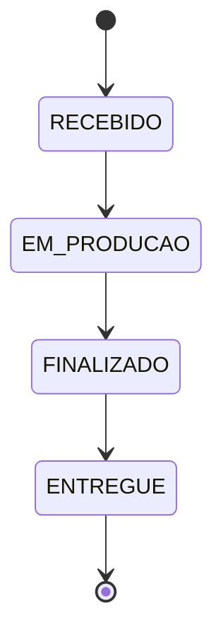
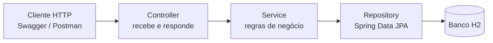
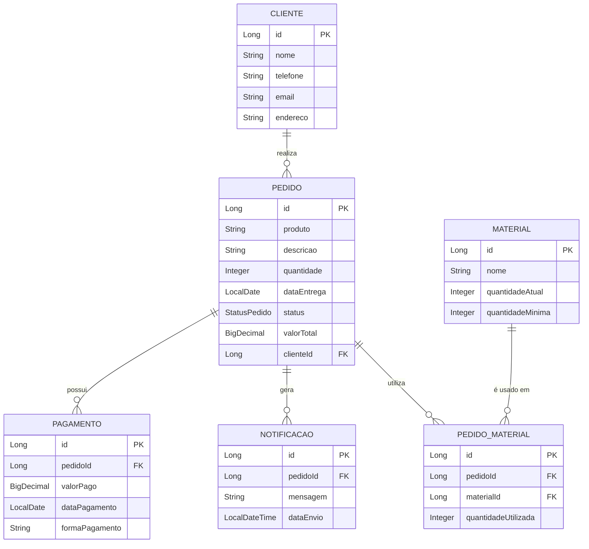

<div align="center">

# 📦 UniFy Backend

### API REST para gestão de encomendas personalizadas

Clientes, pedidos, pagamentos, estoque e indicadores em **um só lugar**.


</div>

---

## 📑 Sumário

- [Sobre o projeto](#-sobre-o-projeto)
- [O problema que resolvemos](#-o-problema-que-resolvemos)
- [Objetivo](#-objetivo)
- [Funcionalidades](#-funcionalidades)
- [Como o sistema funciona na prática](#-como-o-sistema-funciona-na-prática)
- [Tecnologias](#-tecnologias)
- [Arquitetura](#-arquitetura)
- [Modelo de dados](#-modelo-de-dados)
- [Endpoints da API](#-endpoints-da-api)
- [Como executar](#-como-executar)
- [Estrutura do projeto](#-estrutura-do-projeto)
- [Divisão da equipe](#-divisão-da-equipe)
- [Como contribuir](#-como-contribuir)
- [Roadmap](#-roadmap)

---

## 💡 Sobre o projeto

O **UniFy** é o backend de um sistema de gestão para empresas que trabalham com **produtos personalizados sob encomenda**.

Hoje, muitos negócios desse tipo controlam tudo em papel, em conversas de WhatsApp ou em planilhas soltas. O UniFy reúne essas informações em uma única API, de forma organizada, para que o dono do negócio saiba **o que foi pedido, o que já foi pago, o que falta produzir e o que precisa ser comprado**.

> **Em uma frase:** o UniFy transforma o caos das encomendas em informação clara para tomar decisões.

---

## 🔥 O problema que resolvemos

| Problema do dia a dia | Como o UniFy resolve |
|---|---|
| Pedidos desorganizados, sem histórico | Cadastro completo de clientes e pedidos, cada pedido com seu status |
| Não se sabe quanto cada cliente já pagou | Registro de pagamentos parcelados com **cálculo automático do saldo** |
| O material acaba sem aviso | Controle de estoque com **alerta de estoque baixo** |
| Difícil saber em que etapa está cada encomenda | Status do pedido: `RECEBIDO` → `EM_PRODUCAO` → `FINALIZADO` → `ENTREGUE` |
| Falta de números para decidir | **Dashboard** e **relatórios** prontos |
| Comunicação com o cliente não fica registrada | Histórico de notificações (WhatsApp simulado) |

---

## 🎯 Objetivo

Entregar uma **API REST completa e bem documentada** que permita à empresa:

1. **Organizar** os pedidos e os clientes.
2. **Controlar** o financeiro de cada encomenda (entrada, parcelas e saldo pendente).
3. **Acompanhar** o estoque de materiais.
4. **Visualizar** o andamento do negócio por meio de indicadores.

O projeto também é uma **demonstração prática de boas práticas com Spring Boot**: arquitetura em camadas, DTOs, relacionamentos JPA, regras de negócio e documentação com Swagger.

---

## ✨ Funcionalidades

### 👥 Clientes
Cadastrar, atualizar, buscar, listar e excluir clientes (nome, telefone, e-mail e endereço).

### 🧾 Pedidos
Criar, atualizar, consultar e listar pedidos, além de **atualizar o status** ao longo da produção.

### 💰 Controle financeiro
- Registrar pagamentos de um pedido (um pedido pode ter **vários pagamentos**).
- Consultar o **saldo pendente**.
- Listar pedidos **pagos** e **pendentes**.

### 📦 Controle de estoque
- Cadastrar e atualizar materiais.
- Registrar **entradas** e **saídas**.
- Sinalizar **estoque baixo** quando a quantidade atinge o mínimo.

### 📊 Dashboard
Um único endpoint com os principais números do negócio: total de clientes, pedidos, pedidos em produção, entregues, total recebido e total pendente.

### 📈 Relatórios
Relatórios de **pedidos**, **financeiro** e **estoque**.

### 💬 Notificações (versão acadêmica)
Registro do histórico de mensagens enviadas aos clientes. Não há integração com a API oficial do WhatsApp: as mensagens são **simuladas e armazenadas**.

---

## 🧩 Como o sistema funciona na prática

Exemplo de uma encomenda de **R$ 1.000,00**:

1. O cliente é cadastrado e o pedido é criado com status `RECEBIDO`.
2. O cliente paga a entrada: **R$ 300** → saldo pendente: **R$ 700**.
3. O pedido entra em produção (`EM_PRODUCAO`) e os materiais usados saem do estoque.
4. O cliente paga a segunda parcela: **R$ 300** → saldo pendente: **R$ 400**.
5. O pedido fica pronto (`FINALIZADO`) e uma notificação é registrada: *"Seu pedido está pronto."*
6. Na entrega, o cliente paga os **R$ 400** restantes → saldo: **R$ 0** e o pedido passa para `ENTREGUE`.

O saldo é sempre calculado automaticamente:

```
Saldo = Valor Total do pedido - Total já pago
```

### Ciclo de vida do pedido



---

## 🛠 Tecnologias

| Tecnologia | Para que serve |
|---|---|
| **Java 17+** | Linguagem da aplicação |
| **Spring Boot** | Framework para criar a API REST |
| **Spring Data JPA** | Acesso ao banco de dados sem escrever SQL manualmente |
| **H2 Database** | Banco de dados em memória usado nesta fase do projeto |
| **Swagger / OpenAPI** | Documentação interativa dos endpoints |
| **Maven** | Gerenciamento de dependências e build |

> ℹ️ Nesta fase usamos o **H2** por ser simples de configurar. Como o acesso ao banco é feito via JPA, uma migração futura para outro banco (como o PostgreSQL) exige apenas trocar a dependência e as propriedades de conexão.

---

## 🏗 Arquitetura

O projeto segue uma **arquitetura em camadas**, onde cada camada tem uma responsabilidade clara:



| Camada | Responsabilidade |
|---|---|
| **Controller** | Recebe a requisição, valida os dados e devolve a resposta HTTP |
| **Service** | Contém as regras de negócio (cálculo de saldo, baixa de estoque, troca de status) |
| **Repository** | Conversa com o banco de dados |
| **DTO** | Objetos usados para entrada e saída da API, sem expor as entidades diretamente |
| **Entity** | Classes que representam as tabelas do banco |

---

## 🗂 Modelo de dados



**Como ler o diagrama:**

- Um **cliente** pode ter **vários pedidos**.
- Um **pedido** pode ter **vários pagamentos** e **várias notificações**.
- Um **pedido** pode usar **vários materiais**, e um **material** pode ser usado em **vários pedidos**. Essa relação é feita pela tabela `PEDIDO_MATERIAL`, que guarda a quantidade usada.

---

## 🔌 Endpoints da API

> Todos os endpoints ficam documentados e podem ser testados no Swagger (veja [Como executar](#-como-executar)).
> Os endpoints abaixo são a proposta de padronização da equipe e podem sofrer ajustes durante o desenvolvimento.

### Clientes

| Método | Endpoint | Descrição |
|---|---|---|
| `POST` | `/clientes` | Cadastrar cliente |
| `GET` | `/clientes` | Listar clientes |
| `GET` | `/clientes/{id}` | Buscar cliente |
| `PUT` | `/clientes/{id}` | Atualizar cliente |
| `DELETE` | `/clientes/{id}` | Excluir cliente |

### Pedidos

| Método | Endpoint | Descrição |
|---|---|---|
| `POST` | `/pedidos` | Criar pedido |
| `GET` | `/pedidos` | Listar pedidos (filtro opcional `?status=`) |
| `GET` | `/pedidos/{id}` | Consultar pedido |
| `PUT` | `/pedidos/{id}` | Atualizar pedido |
| `PATCH` | `/pedidos/{id}/status` | Atualizar status do pedido |

### Financeiro

| Método | Endpoint | Descrição |
|---|---|---|
| `POST` | `/pagamentos` | Registrar pagamento |
| `GET` | `/pagamentos?pedidoId={id}` | Consultar pagamentos de um pedido |
| `GET` | `/financeiro/saldo/{pedidoId}` | Consultar saldo pendente |
| `GET` | `/financeiro/pedidos?situacao=PAGO` ou `PENDENTE` | Listar pedidos pagos ou pendentes |

### Estoque

| Método | Endpoint | Descrição |
|---|---|---|
| `POST` | `/materiais` | Cadastrar material |
| `PUT` | `/materiais/{id}` | Atualizar material |
| `GET` | `/materiais` | Consultar estoque |
| `POST` | `/materiais/{id}/entrada` | Registrar entrada |
| `POST` | `/materiais/{id}/saida` | Registrar saída |

### Notificações

| Método | Endpoint | Descrição |
|---|---|---|
| `POST` | `/notificacoes` | Registrar mensagem enviada ao cliente |
| `GET` | `/pedidos/{id}/notificacoes` | Histórico de notificações do pedido |

### Dashboard e relatórios

| Método | Endpoint | Descrição |
|---|---|---|
| `GET` | `/dashboard` | Indicadores gerais |
| `GET` | `/relatorios/pedidos` | Total de pedidos e pedidos por status |
| `GET` | `/relatorios/financeiro` | Faturamento total, valores recebidos e pendentes |
| `GET` | `/relatorios/estoque` | Materiais com estoque baixo e quantidade disponível |

### Exemplos

**Registrar uma notificação**

```http
POST /notificacoes
Content-Type: application/json

{
  "pedidoId": 1,
  "mensagem": "Seu pedido está pronto."
}
```

**Resposta do dashboard**

```http
GET /dashboard
```

```json
{
  "totalClientes": 50,
  "totalPedidos": 180,
  "pedidosEmProducao": 30,
  "pedidosEntregues": 120,
  "totalRecebido": 15000,
  "totalPendente": 3000
}
```

---

## 🚀 Como executar

### Pré-requisitos

- [Java JDK 17 ou superior](https://adoptium.net/)
- [Maven](https://maven.apache.org/) (ou use o `mvnw` que acompanha o projeto, se existir)
- [Git](https://git-scm.com/)

### Passo a passo

```bash
# 1. Clone o repositório
git clone <URL-DO-REPOSITORIO>

# 2. Entre na pasta do projeto
cd <NOME-DA-PASTA>

# 3. Execute a aplicação
mvn spring-boot:run
```

A aplicação sobe em `http://localhost:8080`.

### Acessos úteis

| O quê | Endereço |
|---|---|
| **Swagger UI** (documentação e testes) | http://localhost:8080/swagger-ui/index.html |
| **Console do H2** (ver as tabelas) | http://localhost:8080/h2-console |

### Configuração do banco H2

Os dados de conexão ficam em `src/main/resources/application.yaml` (ou `application.yml`, o Spring Boot aceita as duas extensões):

```yaml
spring:
  datasource:
    url: jdbc:h2:mem:unifydb
    driver-class-name: org.h2.Driver
    username: sa
    password:
  jpa:
    hibernate:
      ddl-auto: update
    show-sql: true
  h2:
    console:
      enabled: true
      path: /h2-console
```

No console do H2, use a URL JDBC `jdbc:h2:mem:unifydb`, usuário `sa` e senha vazia.

> ⚠️ **Atenção:** com `jdbc:h2:mem` os dados são **apagados toda vez que a aplicação é reiniciada**. Para manter os dados em disco, troque a URL por `jdbc:h2:file:./data/unifydb`.

---

## 📁 Estrutura do projeto

O código é organizado **por módulo**, para que cada integrante trabalhe na sua própria pasta com menos conflitos no Git.

```
src/main/java/com/unify
├── config/          # Configurações (Swagger/OpenAPI)
├── exception/       # Tratamento global de erros
├── cliente/         # controller, service, repository, dto, model
├── notificacao/     # controller, service, repository, dto, model
├── pedido/          # controller, service, repository, dto, model
├── financeiro/      # controller, service, repository, dto, model
├── estoque/         # controller, service, repository, dto, model
├── dashboard/       # controller, service, dto
└── relatorio/       # controller, service, dto
```

> O nome do pacote base (`com.unify`) é uma sugestão. Ajuste conforme o projeto real.

---

## 👨‍💻 Divisão da equipe

| Integrante | Módulo | Responsabilidades |
|---|---|---|
| **Integrante 1** | Clientes + Notificações | CRUD de clientes e histórico de notificações |
| **Integrante 2** | Pedidos | CRUD de pedidos e controle de status |
| **Integrante 3** | Financeiro | Pagamentos, regra de saldo e consultas financeiras |
| **Integrante 4** | Estoque | Materiais, entradas, saídas e alerta de estoque baixo |
| **Integrante 5** | Dashboard + Relatórios + Swagger + Integração final | Indicadores, relatórios, documentação da API e junção dos módulos |

<!-- Substitua "Integrante N" pelo nome e link do GitHub de cada pessoa -->

---

## 🤝 Como contribuir

1. Crie uma **branch** a partir da `main` com o nome do seu módulo:
   ```bash
   git checkout -b feature/nome-do-modulo
   ```
2. Faça **commits pequenos** com mensagens claras, por exemplo: `feat(pedido): criar endpoint de status`.
3. Abra um **Pull Request** e peça revisão de outro integrante antes de fazer o merge.
4. Não exponha entidades diretamente na API: use sempre **DTOs**.
5. Documente cada novo endpoint no **Swagger**.
6. Avise o grupo antes de alterar entidades compartilhadas (`Pedido`, `Cliente`).

---

## 🗺 Roadmap

- [x] Definição do escopo e do PRD
- [x] Diagramas UML e divisão de tarefas
- [ ] **Sprint 0:** projeto base, H2, entidades e DTOs, tratamento de erros
- [ ] **Sprint 1:** CRUDs de cada módulo
- [ ] **Sprint 2:** regras de negócio (saldo, estoque, status)
- [ ] **Sprint 3:** dashboard, relatórios, Swagger, testes e apresentação
- [ ] Futuro: migrar para PostgreSQL
- [ ] Futuro: autenticação e perfis de usuário
- [ ] Futuro: integração real com a API do WhatsApp

---

<div align="center">

Projeto acadêmico desenvolvido em equipe • **UniFy Backend**

</div>